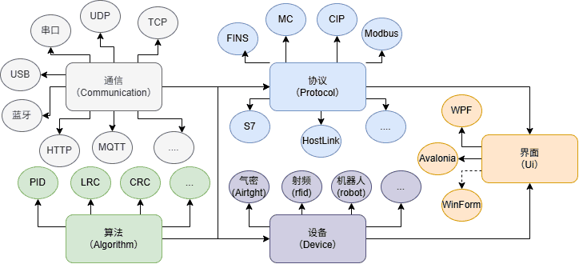
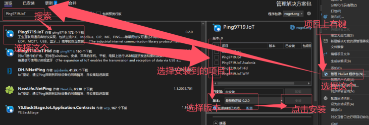

# Ping9719.IoT

Cross-platform industrial communication library. It includes mainstream communication methods (TCP, UDP, MQTT, USB, Bluetooth, etc.) and mainstream communication protocols (Modbus, S7, CIP, MC, FINS, etc.). It is ready to use, simple, and convenient.

## Language Selection
[简体中文](README.md) || [English](README_en-US.md)    

## Documentation Links  <a id="DocMain"></a>
[Go to Documentation](Ping9719.IoT/docs/README.md)    
[Version History](Ping9719.IoT/docs/VERSION.md)    

[Source Code (Primary Repository: GitHub)](https://github.com/ping9719/IoT)   
[Source Code (Backup Repository: Gitee)](https://gitee.com/ping9719/IoT)    
[Submit Issues / Report Bugs](https://github.com/ping9719/IoT/issues)    

## Project Architecture Diagram


## How to Install?


## Package Names and Descriptions

| Package Name (NuGet)  | Environment                      | Description                                                                                                                                     |
|-----------------------|----------------------------------|-------------------------------------------------------------------------------------------------------------------------------------------------|
| Ping9719.IoT          | net45 ; netstandard2.0 ; net8.0 | Cross-platform industrial communication library. Includes basic communication methods, communication protocols, common algorithms, and common device protocols. |
| Ping9719.IoT.Hid      | net45 ; netstandard2.0 ; net8.0 | Cross-platform industrial communication library Hid extension library. Includes less commonly used communication methods (USB, Bluetooth, serial port). |
| Ping9719.IoT.WPF</br>(Not yet released)      | net45 ; net8.0-windows | Control library. Controls implemented for communication methods, communication protocols, and common algorithms. |
| Ping9719.IoT.Avalonia</br>(Not yet released) | net8.0 ; netstandard2.0 | Control library. Controls implemented for communication methods, communication protocols, and common algorithms. |

## Four Highlights

### 1. <b>Common protocols</b> implement `IClientData` or `IReadWrite`, and can be read from or written to in a generic manner.  
```CSharp
client.Read<bool>("abc");//Read 1 item
client.Read<bool>("abc", 5);//Read 5 items
client.Write<bool>("abc", true);//Write 1 item
client.Write<int>("abc", new int[] { 10, 20, 30 });//Write multiple items
```

### 2. <b>All client protocols</b> can be quickly switched to different transport methods, such as from `TCP` to `USB`
> Here, `ModbusRtu` is used as an example; it supports only serial port by default. However, if you want to implement `ModbusRtuOverTcpClient` (using TCP to carry the `ModbusRtu` protocol), the same applies to other cases.

```CSharp
var client = new ModbusRtuClient(new SerialPortClient("COM1", 9600));//Use serial port mode; default
client = new ModbusRtuClient(new TcpClient("127.0.0.1", 502));//TCP mode can also be used directly; ModbusRtuOverTcpClient
client.Client.ConnectionMode = ConnectionMode.AutoReconnection;
client.Client.Open();//Open

//Switch to USB mode. Old properties are retained; if the old one is already open, it will automatically close the old one and open the new one.
client.SetClient(new UsbHidClient(UsbHidClient.GetNames[0]));
```

### 3. Client `ClientBase` provides rich features and high code consistency.   
> The following code is fully generic and applies to `TcpClient`, `SerialPortClient`, `UsbHidClient`, etc.
```CSharp
ClientBase client = new TcpClient("127.0.0.1", 502);//TCP mode
client.Encoding = Encoding.UTF8;

//1: Connection mode. Auto-reconnection is used frequently.
client.ConnectionMode = ConnectionMode.Manual;//Manual. You need to open and close it yourself; this mode is more flexible.
client.ConnectionMode = ConnectionMode.AutoOpen;//AutoOpen. When Open() has not been called, each send and receive automatically opens and closes, which is suitable for short-connection scenarios; if a temporary long connection is needed, you can also call Open() and then Close().
client.ConnectionMode = ConnectionMode.AutoReconnection;//AutoReconnection. After Open() is executed, it automatically reopens if a disconnection is detected, which is suitable for long-connection scenarios. Calling Close() stops reconnection.

//2: Receive mode. Handle sticky packets in the way you consider best.
client.ReceiveMode = ReceiveMode.ParseByteAll();
client.ReceiveModeReceived = ReceiveMode.ParseByteAll();

//3: Data processors. You can add a newline when sending, remove a newline when receiving, or customize.
client.SendDataProcessors.Add(new EndAddValueDataProcessor("\r\n", client.Encoding));
client.ReceivedDataProcessors.Add(new EndClearValueDataProcessor("\r\n", client.Encoding));

//4: Event-driven.
client.Opened += (a) => { Console.WriteLine("Connected."); };
client.Closed += (a, b) => { Console.WriteLine($"Closed successfully. Close code: {b}"); };
client.Received += (a, b) => { Console.WriteLine($"Message received: {a.Encoding.GetString(b)}"); };

client.Open();//Open; configure properties and events before opening

//5: Simple send, receive, and send-and-wait operations.
client.Send("abc");//Send
client.Receive();//Receive
client.Receive(3000);//Receive with a 3-second timeout
client.Receive(ReceiveMode.ParseToEnd("\n", 3000));//Receive data ending with the \n string, with a 3-second timeout
client.SendReceive("abc", 3000);//Send and wait to receive data, with a 3-second timeout
client.SendReceive("abc", ReceiveMode.ParseToEnd("\n", 3000));//Send and receive data ending with the \n string, with a 3-second timeout
```

### 4. The return type is uniformly `IoTResult`, so you no longer need to use `Try` separately to handle exception information.
> `IoTResult<T>` contains `Value`; `IoTResult` does not.
```CSharp
var info = client.Read<bool>("abc");
if (info.IsSucceed)//Check the result before getting the value
   var val = info.Value;
else
   var err = info.ErrorText;
```